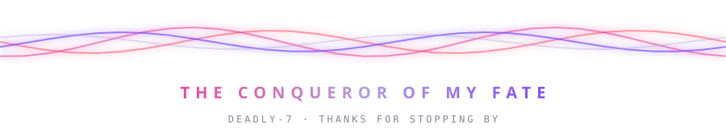

 

 

 

**Miyu** is my main project: a private music and community bot built on discord.js v14 and Lavalink v4.

  
  

Cards rendered by Miyu itself

 

  
   
  
   
  Live from my bot: the track Miyu is playing at this moment

 

  

 

  

  

  <picture>
    <source media="(prefers-color-scheme: dark)" srcset="https://raw.githubusercontent.com/deadly-7/deadly-7/output/github-snake-dark.svg" />
    
  </picture>

 

  Talk Discord bots with me: 
  <a href="mailto:deadlyisbest160@gmail.com"><b>deadlyisbest160@gmail.com</b></a>

Every graphic above the live sections is generated by <a href="scripts/build.js">scripts/build.js</a>: hand-written SVG animation, no templates.

