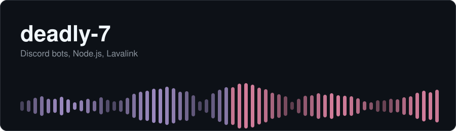
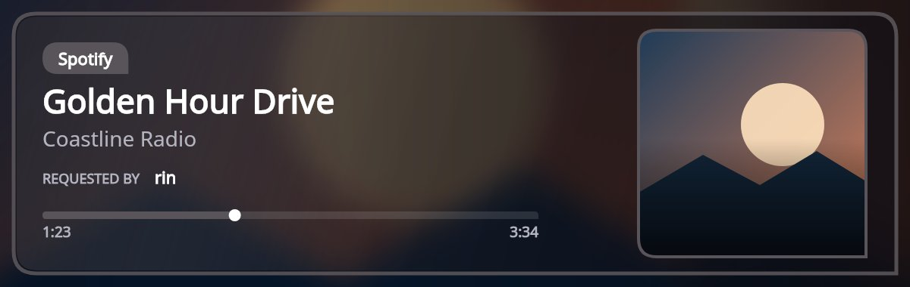
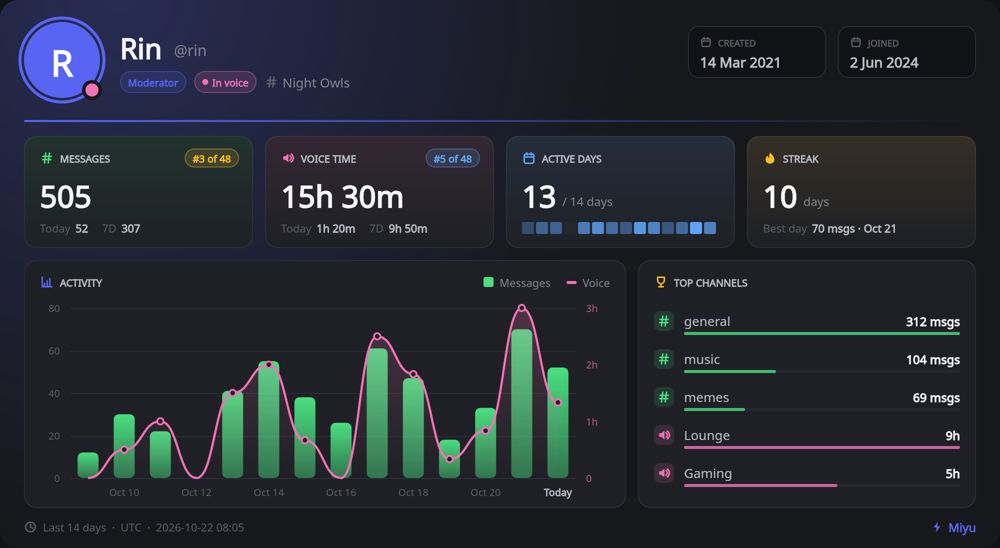

 

"Im The Conqueror Of My Fate"

---

## About

I build Discord bots. My main project is **Miyu** (private), a music and community bot on discord.js v14 and Lavalink v4.

- **Music:** YouTube, YouTube Music, Spotify and SoundCloud, 11 filter presets, 24/7 mode with sessions restored after a restart
- **Moderation:** antinuke, raid detection, automod, case history, cross-server ban list
- **Community:** leveling, tickets, birthdays, economy, giveaways, games
- **Reliability:** tracks Lavalink node health and moves players to a healthy node when one drops

## Tech

  

## Miyu

  
  

### Playing right now

This is the track my bot is playing at this moment.

  

## Contributions

  

  <picture>
    <source media="(prefers-color-scheme: dark)" srcset="https://raw.githubusercontent.com/deadly-7/deadly-7/output/github-snake-dark.svg" />
    
  </picture>

## Contact

deadlyisbest160@gmail.com
